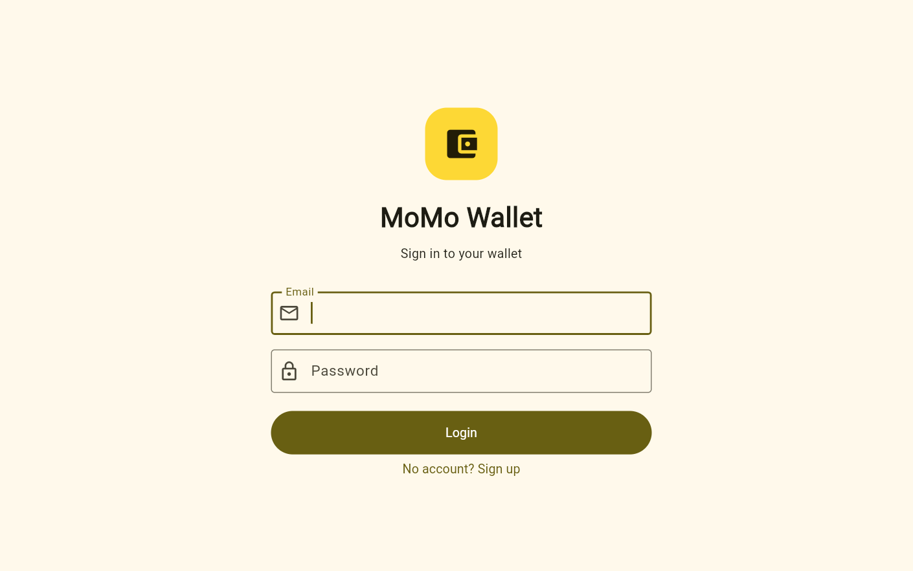
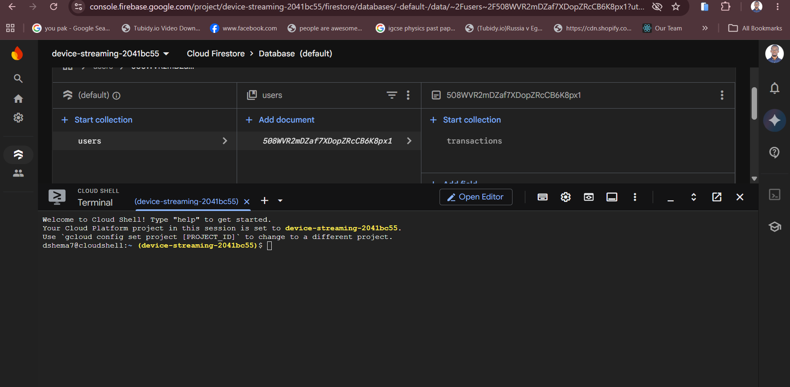
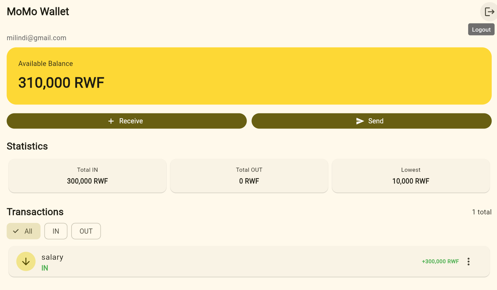
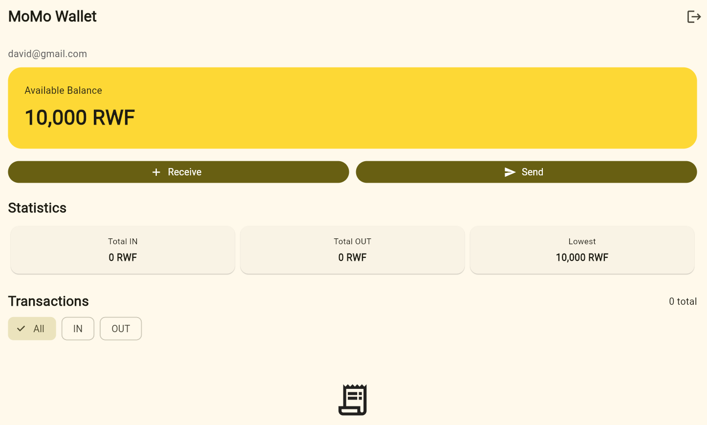

# 💳 MoMo Wallet

A Flutter-based mobile wallet application that demonstrates secure user authentication, cloud-based transaction storage, real-time data updates, and wallet transaction management using Firebase.

MoMo Wallet allows users to create an account, sign in securely, receive and send money, manage transactions, and monitor their wallet statistics. Each user's data is stored separately in Cloud Firestore under their Firebase Authentication user ID.

---

## 📱 Application Overview

MoMo Wallet was developed using **Flutter and Dart** with **Firebase Authentication** and **Cloud Firestore** as the backend services.

The application demonstrates several important mobile development concepts, including:

- Firebase Authentication
- Cloud Firestore
- Real-time data streams
- `StreamBuilder`
- `Future` and `async/await`
- User-specific cloud data
- CRUD operations
- Input validation
- Dynamic balance calculations
- Firestore Security Rules

---

## ✨ Features

### 🔐 Authentication

Users can:

- Create an account using email and password
- Log in to an existing account
- Log out securely
- Access their wallet only after authentication

Firebase Authentication identifies every user with a unique **UID**.

### 💰 Wallet Management

The wallet starts with an opening balance of:

**10,000 RWF**

The current balance is calculated dynamically from the transaction history instead of being stored separately.

This keeps the transaction records as the source of truth.

### 📥 Receive Money

Users can record incoming money by providing:

- A transaction description
- An amount

Incoming transactions are displayed as **IN** transactions and increase the wallet balance.

### 📤 Send Money

Users can record outgoing payments.

Outgoing transactions are displayed as **OUT** transactions and decrease the wallet balance.

### 📊 Wallet Statistics

The application automatically calculates:

- Total money received
- Total money sent
- Current wallet balance
- Lowest wallet balance reached

### 🔎 Transaction Filtering

Transactions can be filtered using:

- **All**
- **IN**
- **OUT**

This makes it easier to view specific transaction types.

### ✏️ Edit Transactions

Existing transactions can be updated directly from the application.

When a transaction is edited, the change is saved to Cloud Firestore and the wallet interface updates automatically.

### 🗑️ Delete Transactions

Transactions can also be deleted.

Deleting a transaction removes the corresponding Firestore document, and the wallet statistics and balance are recalculated automatically.

### ⚡ Real-Time Updates

MoMo Wallet uses a Firestore `Stream` together with Flutter's `StreamBuilder`.

This means changes made to Firestore are reflected in the application automatically without restarting or manually refreshing the application.

---

## ☁️ Firebase Architecture

The application uses two main Firebase services:

### Firebase Authentication

Firebase Authentication manages user accounts and determines which user is currently signed in.

### Cloud Firestore

Every user's transactions are stored underneath their own Firebase UID.

```text
users
│
└── {userId}
    │
    └── transactions
        │
        ├── {transactionId}
        │   ├── description
        │   ├── amount
        │   ├── isIn
        │   └── createdAt
        │
        └── {transactionId}
            ├── description
            ├── amount
            ├── isIn
            └── createdAt
```

A transaction document contains fields such as:

| Field | Description |
|---|---|
| `description` | Description of the transaction |
| `amount` | Transaction amount in RWF |
| `isIn` | Determines whether money is incoming or outgoing |
| `createdAt` | Time when the transaction was created |

---

## 🔒 Data Privacy and Firestore Security

Transactions are stored under:

```text
users/{userId}/transactions/{transactionId}
```

Firestore Security Rules require the user to be authenticated and ensure that the authenticated UID matches the UID associated with the requested wallet data.

This prevents one authenticated account from accessing another user's transactions.

The project does **not** use unrestricted Firestore test-mode rules.

---

# 📸 Screenshots

## 1. Authentication

The login screen allows users to sign in to their MoMo Wallet account using Firebase Email/Password Authentication.



---

## 2. Cloud Firestore Data

Each user's wallet transactions are stored in Cloud Firestore under their unique Firebase Authentication UID.

The structure follows:

```text
users → userId → transactions → transaction
```

The screenshot below demonstrates that transaction data is successfully being stored in Firebase.



---

## 3. Real-Time Firestore Updates

MoMo Wallet listens to Firestore using a real-time stream.

When transaction data changes in Firestore, `StreamBuilder` receives the updated transaction list and rebuilds the relevant interface automatically.

The application therefore displays new data without requiring a restart.



---

## 4. User Data Isolation

Every account has its own transaction collection.

Signing in with a second Firebase account displays that user's own wallet data rather than transactions belonging to another account.

This demonstrates that wallet information is isolated between authenticated users.



---

## 🧠 How the Balance Works

The application does not store the current balance as a separate Firestore value.

Instead, it begins with:

```dart
startingBalance = 10000;
```

and calculates the current balance from the transaction history.

Conceptually:

```text
Current Balance
    =
Opening Balance
    + Total IN
    - Total OUT
```

For example:

```text
Opening Balance       10,000 RWF
Received Salary      +50,000 RWF
Sent Money            -2,500 RWF
                     -----------
Current Balance        57,500 RWF
```

This prevents the stored balance and transaction history from becoming inconsistent.

---

## 🔄 Application Flow

```text
Start Application
       │
       ▼
Firebase Initialization
       │
       ▼
Authentication State
       │
       ├── Not Logged In
       │       │
       │       ▼
       │   Login / Sign Up
       │
       └── Logged In
               │
               ▼
          MoMo Wallet
               │
               ▼
      Firestore Transactions
               │
       ┌───────┼────────┐
       ▼       ▼        ▼
    Receive   Send    Edit/Delete
       │       │        │
       └───────┼────────┘
               ▼
          Cloud Firestore
               │
               ▼
            Stream
               │
               ▼
          StreamBuilder
               │
               ▼
        Updated Wallet UI
```

---

## 🛠️ Technologies Used

| Technology | Purpose |
|---|---|
| Flutter | Mobile application framework |
| Dart | Application programming language |
| Firebase Core | Firebase initialization |
| Firebase Authentication | User registration and login |
| Cloud Firestore | Cloud transaction database |
| Firestore Streams | Real-time transaction updates |
| Git | Source control |
| GitHub | Project repository and submission |

---

## 📦 Main Flutter Packages

The project uses:

```yaml
firebase_core
firebase_auth
cloud_firestore
```

These packages connect the Flutter application to Firebase Authentication and Cloud Firestore.

---

## 📂 Project Structure

```text
momo_wallet/
│
├── android/
├── ios/
├── lib/
│   ├── main.dart
│   └── firebase_options.dart
│
├── screenshots/
│   ├── login.png
│   ├── console.png
│   ├── live.png
│   └── denied.png
│
├── pubspec.yaml
└── README.md
```

---

## ▶️ Running the Project

Install the project dependencies:

```bash
flutter pub get
```

Run the application:

```bash
flutter run
```

For Chrome:

```bash
flutter run -d chrome
```

---

## 🧪 Testing

The application was tested for:

- Account registration
- User login
- User logout
- Adding incoming transactions
- Adding outgoing transactions
- Editing transactions
- Deleting transactions
- Transaction filtering
- Balance calculation
- Wallet statistics
- Firestore persistence
- Real-time Firestore updates
- Data separation between different authenticated accounts

---

## 🚀 Future Improvements

Possible future improvements include:

- Dedicated Send Money screen with phone-number validation
- Cash-out denomination calculation
- Transaction search
- Transaction details screen
- User profile management
- Biometric authentication
- Transaction categories
- Monthly spending analytics
- Improved offline support

---

## 👨‍💻 Project Information

**Project:** MoMo Wallet  
**Framework:** Flutter  
**Language:** Dart  
**Backend:** Firebase  
**Authentication:** Firebase Authentication  
**Database:** Cloud Firestore  

---

## 📄 Summary

MoMo Wallet demonstrates how a Flutter application can move beyond local-only data and work with a real cloud backend.

Firebase Authentication identifies the signed-in user, Cloud Firestore stores each user's transactions separately, Firestore Security Rules protect the data, and real-time streams keep the wallet interface synchronized with changes in the database.
